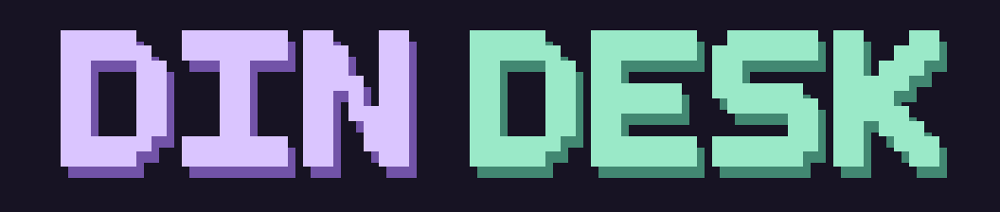

<h1 align="center">
  
</h1>

<p align="center">
  <a href="https://github.com/thanhdiner/din-desk/releases/download/v0.1.0-beta.26/DinDesk-0.1.0-beta.26-win-x64.zip"></a>
  <a href="https://github.com/thanhdiner/din-desk/releases/download/v0.1.0-beta.26/DinDesk.exe"></a>
  <a href="https://github.com/thanhdiner/din-desk/releases/tag/v0.1.0-beta.26"></a>
</p>

<p align="center">
  <a href="docs/WINDOWS_RELEASE.md">Hướng dẫn Windows</a> ·
  <a href="docs/CLAUDE_CODE.md">Claude Code</a> ·
  <a href="docs/GEMINI_WEB.md">Gemini Web</a>
</p>

Din Desk chạy proxy cục bộ trên Windows để dùng tài khoản **Muse** hoặc
**Gemini Web** với Claude Code, Codex CLI và Claude Desktop.

## Tải Din Desk cho Windows

**v0.1.0-beta.26 · Windows 10/11 x64**

| Tệp | Nội dung |
| --- | --- |
| [Tải ZIP portable](https://github.com/thanhdiner/din-desk/releases/download/v0.1.0-beta.26/DinDesk-0.1.0-beta.26-win-x64.zip) | EXE, hướng dẫn tiếng Việt và giấy phép thư viện |
| [Tải DinDesk.exe](https://github.com/thanhdiner/din-desk/releases/download/v0.1.0-beta.26/DinDesk.exe) | Chạy trực tiếp với Rust server và .NET runtime tích hợp |
| [Tải SHA-256 của ZIP](https://github.com/thanhdiner/din-desk/releases/download/v0.1.0-beta.26/DinDesk-0.1.0-beta.26-win-x64.zip.sha256) | Đối chiếu với `Get-FileHash -Algorithm SHA256` |

Đăng nhập GitHub bằng tài khoản có quyền truy cập repo để tải.
[Xem các bản phát hành](https://github.com/thanhdiner/din-desk/releases).

1. Giải nén ZIP nếu đã tải gói portable, rồi mở `DinDesk.exe`.
2. Trong **Tài khoản**, thêm tài khoản Muse hoặc Gemini Web và kết nối. Tab
   **Hướng dẫn** có các bước lấy cookie.
3. Cài công cụ bạn muốn dùng, rồi mở từ tab **Bắt đầu** hoặc thiết lập CLI ở
   tab **Cài đặt**. Giữ Din Desk kết nối trong lúc sử dụng.

Mỗi tài khoản có cookie và cấu hình proxy riêng. Din Desk lưu cấu hình bằng Windows DPAPI.

## Tích hợp

**Claude Desktop trên Windows.** Kết nối tài khoản trong Din Desk, sau đó bấm
**Bắt đầu → Mở Claude Desktop** một lần. Những lần sau, mở Claude Desktop trực
tiếp và vào tab **Code** trong khi Din Desk đang kết nối.
[Hướng dẫn cài đặt và cập nhật cấu hình](docs/CLAUDE_CODE.md#claude-desktop-trên-windows)

**Claude Code CLI:** đã có adapter Anthropic Messages và launcher
[`claude-muse.ps1`](claude-muse.ps1). Xem [cách cấu hình và giới hạn](docs/CLAUDE_CODE.md).
Tool calling qua prompt JSON đã thử vòng Read → Write với Muse thật; SSE của
adapter này đệm nội dung tới khi kiểm tra xong, usage là ước lượng.
Launcher nhận diện riêng từng phiên Claude; các lượt tiếp theo tái dùng
session/socket và gửi phần lịch sử mới khi prefix/system/tools khớp chính xác.
Client budget mặc định 256k, JSON/context tối đa 4 MiB; giới hạn token native
của Muse cá nhân chưa được xác minh bằng các thông số này.
Đã hỗ trợ ảnh base64 ở user/tool_result và thử thật qua Claude Code `Read`.
Mỗi ảnh tối đa 2 MiB sau giải mã base64; xem [giới hạn ảnh](docs/CLAUDE_CODE.md).

Claude Code mở qua launcher có công cụ tìm kiếm web Exa MCP không cần API key
để bắt đầu (có giới hạn tần suất). Xem [tìm kiếm web](docs/CLAUDE_CODE.md#tìm-kiếm-web).

**Codex CLI** dùng `/v1/responses` với model `muse` hoặc `gemini` và cấu hình
context từ Din Desk. Trong **Cài đặt**, bấm **Setup Claude Code** hoặc **Setup
Codex** rồi mở PowerShell mới để dùng `cy` hoặc `cx`. Hai lệnh chạy tại thư mục
terminal, dùng API key đang lưu và bỏ lời hỏi duyệt thao tác của CLI.

## Kiến trúc

Ứng dụng được chia theo hexagonal:

- `ports.rs` định nghĩa cổng nhận message đã giải mã; `core/echo.rs` chứa use case mẫu, không phụ thuộc Axum hoặc Noise.
- `api/` nhận kết nối Axum WebSocket, quản lý phiên và gọi core qua port.
- `adapters/noise.rs` xử lý bắt tay và mã hóa Noise cho từng kết nối; đây là chi tiết của lớp giao tiếp, không đi vào application.
- `lib.rs` là composition root, nối adapter với use case. `main.rs` khởi động server và `config.rs` đọc cấu hình.

Khi thêm nghiệp vụ, bổ sung use case và port theo nhu cầu; adapter chuyển dữ liệu từ giao thức vào port. Các cổng tới database hoặc dịch vụ ngoài chỉ cần thêm khi ứng dụng thực sự sử dụng chúng.

## Tiến độ kết nối Muse trực tiếp

`POST /v1/chat/completions` có triển khai thử nghiệm theo hướng kết nối trực tiếp: cookie → VM/token → WebSocket Noise XX → protobuf → subscription → SSE. Client dùng lại kết nối và xử lý từng lượt tuần tự. Trước khi gửi trên socket đã dùng, proxy gọi `/api/ping` với timeout 5 giây; nếu kết nối đã chết thì bootstrap lại VM/token và mở socket mới trước khi gửi nội dung user. Khi lỗi xảy ra trong lượt đang gửi, proxy báo lỗi cụ thể và không tự gửi lại tin nhắn vì có thể Muse đã nhận. `GET /ws` vẫn là demo echo Noise NN riêng.

Thiết lập trong PowerShell trước khi chạy server:

```powershell
$env:MUSE_COOKIE = '<cookie đăng nhập Muse do bạn tự cung cấp>'
$env:MUSE_NODE_ID = '<mã node ổn định của bạn>'
cargo run
```

Đừng đưa cookie vào source, Git hoặc log. Server chỉ đọc cấu hình lúc khởi động. API hỗ trợ `model: "muse"`, JSON response mặc định và SSE khi `stream: true`. Ví dụ streaming:

```powershell
curl.exe -N http://127.0.0.1:3000/v1/chat/completions `
  -H 'Content-Type: application/json' `
  -d '{"model":"muse","stream":true,"messages":[{"role":"user","content":"Xin chào"}]}'
```

**Đã thử với Muse thật ngày 12/11/2026:** hai lượt liên tiếp trả về `OK` và `PONG` qua SSE, có `finish_reason: "stop"` và `[DONE]`; lượt thứ hai dùng lại kết nối. Bộ kiểm thử cục bộ vẫn dùng server giả lập để kiểm tra các lỗi giao thức.

## Conversation riêng

Mỗi conversation của proxy ánh xạ tới một session Muse riêng. Kết nối WebSocket được dùng lại độc lập với conversation; kết nối lại không đổi session hay xóa ngữ cảnh.

- `POST /v1/conversations`: tạo chat riêng, trả `{id, created}`.
- `GET /v1/conversations`: liệt kê các conversation do proxy tạo cho VM/tài khoản hiện tại.
- `GET /v1/conversations/{id}`: kiểm tra conversation và session Muse tương ứng còn tồn tại.
- `POST /v1/chat/completions`: thêm `conversation_id` để tiếp tục chat đó. Nếu bỏ qua, proxy tạo chat riêng mới cho request và trả ID trong header `X-Conversation-Id`.

Lưu ID trả về rồi truyền vào các lượt tiếp theo:

```powershell
$conversation = Invoke-RestMethod http://127.0.0.1:3000/v1/conversations -Method Post
$body = @{ model = 'muse'; stream = $true; conversation_id = $conversation.id; messages = @(@{ role = 'user'; content = 'Xin chào' }) } | ConvertTo-Json -Depth 5 -Compress
curl.exe -N http://127.0.0.1:3000/v1/chat/completions -H 'Content-Type: application/json' -d $body
```

Ánh xạ được lưu tại `.local/conversations.json` (đã gitignore), chỉ chứa ID/VM và thời gian tạo; không lưu cookie hoặc nội dung tin nhắn. Đổi đường dẫn bằng `MUSE_CONVERSATIONS_PATH`. Giữ file này để tiếp tục conversation bằng `conversation_id` sau khi restart server. File store dành cho một server process; cần shared store khi chạy nhiều instance.

Muse giữ lịch sử của từng session. Proxy nhận delta realtime nếu có; sau ít nhất 2 giây không có thay đổi nội dung realtime, proxy kiểm tra lịch sử đúng session mỗi giây để nhận phản hồi bị thiếu. Các reply hoàn tất được sắp theo sequence và chống phát lại theo message ID. Không gửi đồng thời từ ứng dụng Muse vào cùng session đang được proxy xử lý.

### Vòng đời task và tiến độ

Một `delta.message_done` chỉ đóng một reply. Khi nhận được trạng thái root task, proxy chờ root hoàn tất, hết task con và hết reply đang mở, rồi đợi yên 1 giây trước khi gửi `finish_reason: "stop"` / `[DONE]`. Nhiều reply được nối bằng hai ký tự xuống dòng. Progress từ `agent.status` nằm trong `muse_proxy: {kind: "progress", text, activity_code}`, không trộn vào `delta.content`. Sự kiện bị hủy có `muse_proxy.kind: "cancel"`; task lỗi trả error, không giả thành hoàn tất.

Nếu Muse chỉ cung cấp lịch sử, không có root task được xác định, proxy dùng điều kiện dự phòng: đã có reply hoàn tất, không còn reply đang mở và yên 3 giây. Đây là heuristic, không chứng minh task upstream kết thúc; reply đến muộn hơn vẫn có thể bị bỏ lỡ trong chế độ này. Ngắt HTTP chỉ dừng chờ và đóng kết nối của conversation, chưa gửi lệnh hủy task lên Muse.

Mỗi conversation có socket Noise riêng và một khóa tuần tự; tối đa 4 conversation hoạt động cùng lúc, 64 lượt active/chờ, 32 kết nối cache. Hàng chờ tối đa 15 giây, deadline của `run` là 120 giây gồm chờ khóa, bootstrap và xử lý; tạo conversation trước `run` chưa nằm trong deadline này. Bootstrap được tuần tự để tránh tranh chấp xác thực. Metadata conversation dùng file store như trên.

Đã kiểm tra thật: conversation A nhớ mã thử nghiệm, conversation B không thấy mã đó, và A vẫn nhớ sau khi restart server rồi tiếp tục bằng cùng `conversation_id`.

### API compatibility

- `GET /v1/models`, `GET /v1/models/muse`: model catalog, không gọi Muse.
- `stream: false` hoặc không có `stream`: chờ cả lượt rồi trả JSON `chat.completion`, ghép các reply; không có usage ước lượng.
- `stream: true`: trả role, content/progress/widgets, terminal event và `[DONE]`. `stream_options.include_usage: true` thêm chunk `choices: [], usage: null` vì Muse không cung cấp token usage đã xác minh.
- Widget gợi ý nằm trong `choices[0].delta.muse_quick_replies`, gồm `id` và `options`. `delta.content` chỉ chứa text đã bỏ marker `[[hatch_widget:...]]`.
- `messages`: chấp nhận mảng nhiều message, nhưng **chỉ gửi user message cuối cùng** vào session hiện tại. User content có thể là string hoặc mảng part `text`/`input_text`, giới hạn 32.768 byte. Lịch sử cũ và chỉ dẫn `system`/`developer` không được gửi lại, Muse quản lý history/persona. Nếu không truyền `conversation_id`, lịch sử trong request cũng không được dùng để tái tạo conversation.
- `tools`, `functions`, tool choice thực sự, ảnh/audio, structured output, custom stop, logprobs và `n != 1`: trả 400 khi được yêu cầu. Các tham số sinh như `temperature`, `top_p`, `max_tokens` và trường lạ khác được bỏ qua cho compatibility, không điều khiển Muse.
- Confidential VM cần recovery credentials vẫn chưa hỗ trợ. Din Desk yêu cầu API key cho các route API localhost. Xem [cách đổi key và đặt hạn](docs/WINDOWS_RELEASE.md).

Giao thức nội bộ Muse có thể thay đổi. [Tài liệu tham khảo muse-cli](https://github.com/nikships/muse-cli/blob/main/docs/PROTOCOL.md) ghi nhận một số môi trường có thể yêu cầu TLS fingerprint của trình duyệt. Lần kiểm tra trên máy hiện tại sử dụng trực tiếp Rust TLS và không cần trình duyệt chạy kèm.

## Chạy

### Server

Cài Rust toolchain ổn định, sau đó:

```powershell
cargo run
cargo test
```

Mặc định server nghe tại `127.0.0.1:3000`. Đổi địa chỉ bằng `$env:BIND_ADDR = "0.0.0.0:3000"`. `GET /health` trả về `ok`, `GET /ws` nâng cấp thành WebSocket.

### Cấu hình log

`RUST_LOG` là biến môi trường dùng để chọn log hiển thị. Trong PowerShell, đặt biến trước khi chạy server:

```powershell
$env:RUST_LOG = "muse_api=debug"  # Hiển thị thêm log debug của dự án
cargo run
```

Xem giá trị hiện tại bằng `$env:RUST_LOG`. Biến đặt theo cách này chỉ tồn tại trong phiên PowerShell hiện tại; mở terminal mới thì đặt lại. Nếu `RUST_LOG` chưa được đặt hoặc không hợp lệ, ứng dụng dùng `muse_api=info` làm mặc định. Dự án hiện chưa tự đọc file `.env`.

## Giao thức WebSocket

- Noise pattern: `Noise_NN_25519_ChaChaPoly_BLAKE2s`; client là initiator, server là responder.
- Mỗi thông điệp Noise nằm trong một WebSocket binary message. Client gửi handshake đầu tiên với payload rỗng; server trả handshake thứ hai với payload rỗng. Sau đó hai bên chuyển sang transport mode.
- Mỗi binary message tiếp theo là một Noise transport message. Server giải mã rồi echo lại nội dung trong một transport message mã hóa. Giới hạn mỗi thông điệp Noise là 65.535 byte; với ChaChaPoly, plaintext transport tối đa là 65.519 byte. Text message và Noise message không hợp lệ sẽ đóng phiên.
- Xem `tests/websocket.rs` để biết ví dụ client Rust hoàn chỉnh.

**Bảo mật:** Noise NN không xác thực danh tính server hay client và không chống được kẻ trung gian chủ động. Đây là khung demo; khi triển khai thực tế cần chọn pattern và cơ chế xác thực khóa phù hợp (ví dụ ghim khóa server), dùng WSS/TLS khi cần bảo vệ kết nối HTTP và metadata, và bổ sung xác thực, phân quyền, giới hạn kết nối theo yêu cầu.
